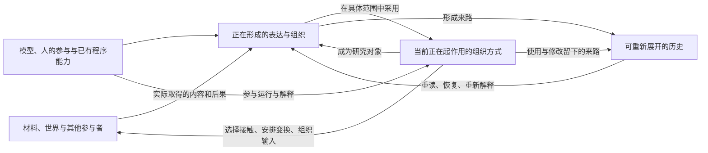

# Cognos 总设计 v0.1

## 先读这里

这份文件落实已接受总计划中当前优先的工作：从思想依据推导整体运行构想，并决定什么值得进入实现设计。它不是另一份待执行的总计划。

本轮提出的核心假设是：**让系统形成的把握，能够参与组织它接下来如何接触、解释和作用；又让这种正在起作用的组织，能够在活动中重新成为被认识、被改变的对象。**

这句话需要下文的具体机制才能成立。单有可编辑笔记、可调用方法或“自我反思”提示，还不能说明这件事发生了。

相比前两份候选，本轮改变了三处判断：

1. 不再以“文本还是代码”区分真假结构。语言、图形、程序、模型内部状态都可能实际参与认识；需要说明它们怎样起作用。
2. 把“所形成的内容”和“当前正在采用的组织方式”接起来。保存一个解释，与让该解释改变后续取得材料、切分对象和展开活动，是不同的作用。
3. 把起初借用的能力明确列出。系统不必从无智能状态开始，但不能把模型或人已经完成的理解，全部归功于新增架构。

当前取得的是可继续推导的架构假设。意义的形成、方向的重要性、主体性的充分条件仍未解决；初版切入也因此附有具体限度。

## 1. 思想依据：哪些东西在持续，哪些发生过变化

### 1.1 目标的来路

最初的学习问题并没有在后来的认识论讨论里消失。学习成绩引出理解与思考，理解与思考引出怎样把握一个东西，继而触及限定、指认、视角、存在的展开与主体的主动性。[S1][S5]

这条来路给设计的要求是：认识不能只被安放在“收到材料之后生成答案”的环节。什么被当作对象、怎样比较、朝什么方向继续，以及谁的能力在改变，都在问题之内。

下面按材料区分要求、推测和架构后果。引述只支持其附近的判断，不把同一份会话中的所有 AI 解释一并认领。

| 材料与位置 | 用户的推进或纠正 | 对本设计的约束 | 仍未确定的部分 |
|---|---|---|---|
| 学习回溯笔记；8 月 8 日来龙去脉 [S1][S5] | 从学习追到理解与思考，再追到认识与存在；“变化”不足以表达主体主动性，因而引入尝试。 | 系统不能只保存结果；要考察怎样理解、怎样继续，以及这些能力怎样变化。 | 这些关系怎样转成具体计算结构，尚无现成答案。 |
| 5 月 31 日 [S2] | “你忽略了创作，学习，尝试……这可以作为一个部分或者一个方向。但不是全部。” | 外部阻力或纠错只是部分情形。创作和学习要直接参与架构推导。 | 这些活动是否共享一套足够有力的机制，仍需展开。 |
| 6 月 1 日，收在 6 月 5 日档案 [S3] | “局部的精准切入是方式不是妥协。” | 初版可以局部实现；选择局部必须说明它与整体问题的关系。 | 局部机制是否可扩展，不能预先保证。 |
| 6 月 7 日 [S4] | “由主体展开尝试，但是主体又是尝试所塑造或者获得的。”并强调触碰、冲突、融合、分裂。 | 当前行动组织需要可改变；主体不能只由固定成员或身份记录代表。 | 这句话还不是第一次尝试或完整主体生成的算法。 |
| 8 月 8 日 [S5] | 对要求填写一次尝试的做法说“我填了，但是都留空……这个就是我的一个特质而已”。 | 可以撤销“这里发生了一次可填表的事件”这个解释。不能只增加一种事件类型继续套入。 | 空白究竟来自表达方式、对象化错误还是别的原因，需要具体材料；不能统一诊断。 |
| 8 月 8 日来龙去脉 [S5] | 未知处在已形成的可能之前；尚不能顺利展开时，也会摸索、触碰。 | 不要求先列出候选、正式问题或明确目标，才允许活动开始。 | 程序里的 unknown 值不能代表尚未形成的全部维度。 |
| 8 月 14 日档案 msg 43 [S6] | 认识具有贯穿性；世界映射、自指、认识与学习的结构也可能需要展开。 | 允许改变表达与组织办法本身。自我描述不能代替实际改变。 | 可修改到什么程度、怎样承接旧活动，仍是设计问题。 |
| 8 月 19 日 [S7] | 用“没钱、数学理想”指出 AI 对词语涉及的空间展开不足，同时保留对小步路径的疑问。 | 需要让对处境的理解影响展开方向，并能重新组织对问题的理解。 | 不预设先建完整经济模型，也不预设一句澄清就足够。 |
| 用户提供的 GPT 上下文 [S8] | “不是展开候选，是尝试，你不知道具体这个空间会遇到什么。” | 新材料和活动后果可以改变问题的组织，不能只在已有答案列表里选。 | 世界映射、最小硬结构、自主动力等是随后探索的方向。 |
| 当前已授权的总计划 [S0] | 优先完成思想依据与整体运行构想；不将测量、方法库或旧实现设为主线。 | 本文必须提出实际推导，不能停在资料整理或工程清单。 | 授权执行路线，不等于预先认可本文的新假设。 |

### 1.2 一处需要保留的来源差别

当前《认识论-核心》写有“第一次尝试问题消解”，并把“尝试和主体同步生成”作为较强解释。[S9] 回到 6 月 7 日原始片段，可以直接确认的是用户说主体与尝试相互塑造；“没有第一次”“同步的生成”等进一步解释出现在后续 AI 回答中。[S4]

本轮没有穷尽这条解释后来是否获得过其他确认，因此不判定整个核心文件错误，也不修改它。这里能确定的是：**不能仅凭核心摘要，把这个更强的解释当成已经由原话证明的设计前提。**

这造成一个具体架构后果：初始模型能力、人的发起、已有材料和执行环境都需要列明。主体可能在持续活动中重组，不意味着起初运行所需的条件已经被解释掉了。

### 1.3 不能直接沿用的几个等同

| 等同 | 本轮处理 |
|---|---|
| 表达成文本 = 只有自述；写成代码 = 真实认知结构 | 撤销。分别检查它们实际改变了什么。 |
| 保存方法 = 系统已学会认识 | 撤销。方法的发现、适用判断与实际使用需要分别交代。 |
| 对象记录有版本 = 对象能够生成和瓦解 | 不充分。还需要允许撤销对象身份、改换划分，以及处理依赖旧划分的活动。 |
| 外界反馈 = 认识的唯一动力 | 撤销。内部推演、学习、创作、人的参与和已有倾向都需要考察。 |
| 有不确定性字段 = 能面对未知 | 不充分。要允许产生原表达中没有的位置与区分。 |
| 换模型后读到同一档案 = 同一主体持续存在 | 不充分。需要看实际承接了哪些组织与能力；主体性仍开放。 |
| 结构变化 = 认识进步 | 撤销。变化也可能带来误解、遗忘、僵化或更差的行动。 |

## 2. 从思想到机制：这一轮的推导

以下为 Codex 的候选推导，不是用户已确认的哲学命题。

### 2.1 世界的差异，需要经过接触和组织才能成为当前可用的差异

即使材料存在差异，系统也未必取得它；即使取得不同数据，也未必知道这种不同在当前活动中意味着什么。

例如同一段话，以关键词读取时看到的是“尝试”；沿说话人、时间与引用关系读取时，可能看到的是“用户描述特质，AI 把它构造成了一次尝试”。原始字符串没有改变，取得和组织关系的方式改变了，当前能够辨别的东西随之改变。

这里至少有三个不能略过的作用：取得材料的办法保留或丢失了哪些差异；表达怎样使某些材料可以关联、区分或比较；已有能力怎样解释这些联系并继续活动。

架构可以参与前两个作用，也可以改变第三个作用所处的条件。具体语义理解仍可能主要由模型与人完成。这不是一个从物理差异自动推出意义的证明。

**由此推得的设计要求：取得方式与组织方式也应可被读取和修改。** 否则系统可以不断增加答案，却一直用原来的方式面对问题。

### 2.2 一种把握的形成，需要能改变它此后怎样使用材料

“这不是一次具体事件，而是关于特质的描述”可以只写在回答里，也可以实际改变后续工作：不再把该段内容送入事件表格；后续再次提及时，保留描述的范围；需要具体事件时，取得额外材料，而不是编一个实例。

两种情形都可能包含理解，区别在于理解是否获得了持续的组织作用。

因此，当前系统不能只回答“存着什么”。还需要回答：**正在依照什么来取得材料、组织对象、安排操作和构造下一次模型输入？**

这也说明旧的“工作构造与方法库”提案为何不够：那里详写了保存与执行，但没有充分推导哪些已形成的把握正在组织活动，以及这种组织怎样被重新打开。

### 2.3 允许改变对象的形成方式，比给对象增加字段更深一层

若“特质描述”被错当成“发生过的一次尝试”，继续给 Attempt 增加 trigger 子类型仍可能保留原错。真正需要改变的可能是：不再把这份材料理解成一次事件。

软件仍然需要稳定标识去重新取得原材料。稳定标识属于技术引用；它不强迫材料所涉及的事物永远具有同一个解释身份。

因此，原始材料、对它的当前组织和依照这个组织采取的做法，要能分别改变。解除一种组织后，材料继续存在；明确依赖它的后续构造需要重新检查；不能宣称所有隐含影响都能被自动追踪。

**认识结构的瓦解，在这个候选中可以有实际含义：一种划分失去当前组织作用，相关活动重新围绕材料展开。** 它不等于删除一个数据库对象，也不等于宣布世界中的事物不存在。

### 2.4 历史需要同时进入当前做法和重新展开的通路

过去可以通过已经形成的解释、习惯、方法、关注方向与操作能力影响现在。有些作用存在于文本使用中，有些存在于外部程序，有些依赖模型内部已有能力。

保存原始来路，使这些当前做法可以被重新审视；当前做法实际起作用，使历史具有超过档案的后果。这两种作用可以并存，也可能各自不完整。

因此不能用“删掉历史文件后行为是否改变”作统一判断。系统可能已经把过去的结果变成当前方法，也可能仍需要重读原话才能理解某个结果。删档案不是本设计的验证方式。

### 2.5 主体问题应进入组织变化之中，不能被推迟为一个人格模块

初始可操作的事实是：人、模型、材料、工具和当前采用的做法一起参与活动。其中谁发起、谁承担后果、哪些能力能被使用、哪些部分能被系统观察和修改，可以具体描述。

随着活动，系统可以改变其可用办法、关注方向、对自身限制的理解和内部协作关系。这为“主体被尝试塑造”提供了一部分可运行内容。

但任意连接的部件集合并不因此成为主体。连续性、一定独立性、方向的维持与改写、对后果的承接，都仍需要具体考察。本候选不以“有自我描述”或“能改自身代码”宣告主体成立。

这里采用有限的初始立场：**先建设能够持续参与活动并改变其组织的系统，同时把主体究竟形成在哪里作为持续的设计问题。** 不提前等同于单个模型，也不把人纳入一个已被定义完毕的“大主体”。

## 3. 整体运行构想

### 3.1 当前实际存在的东西

从运行角度暂时区分四类作用。这是便于说明的工程视角，不是四个认识模块或世界的存在类型全集。

| 当前实际起作用的部分 | 可具有的形态 | 主要作用 |
|---|---|---|
| 可以继续接触的材料与入口 | 原文、图像、程序、作品、外部接口、其他参与者、系统自身的结构 | 使活动有可重新面对的东西；取得结果受真实来源与环境制约。 |
| 正在形成的表达与组织 | 注释、对象划分、图形、局部模型、推演、尚未完整的关联 | 把某些关系置于可比较、可改动、可继续展开的位置。 |
| 当前采用的组织方式 | 取得材料的方式、关联与转换办法、上下文组织、局部操作安排 | 实际改变后续活动能够面对什么、怎样面对。 |
| 参与活动的已有能力 | 模型的生成与理解、人的经验与意图、程序的计算、各参与者的连续状态 | 提出并解释新构造，执行操作，选择或改变方向。 |

同一份表达可以先只是待研究的内容，后来在某个范围内成为实际采用的办法；该办法又可以重新成为研究对象。形态不同的材料可以共存，不要求统一压入一张世界关系表。

### 3.2 一个关键连接：内容怎样获得组织作用

提出一种解释，不自动使它成为所有后续活动的规则。候选需要通过一个具体使用关系进入运行：什么活动正在使用哪一种办法，作用于哪些材料，影响哪一步。

例如，把“按说话人和引用关系重读”用于一组聊天材料，意味着下一次取材会返回相关原话及其上下文，而不是只返回包含同名关键词的摘要。读取程序和上下文组织确实发生变化；对原话的理解仍由参与者完成。

这个使用关系至少有三个性质：

- 作用范围可辨认：某次活动的采用不静默升级为全局规则。
- 内容可以重开：当前采用的解释与办法仍能被重新研究。
- 实际作用可以指出：取得了不同材料、建立了不同对应、执行了不同变换，或以不同组织构造输入；不能只报告“我已改变”。

某些作用可以由程序精确执行，某些通过模型读取语义内容实现。后者不被排除，但需要承认其依赖模型能力且可能不稳定。程序只能强制其明确承担的契约，不能通过硬门控裁定开放语义的真伪。

### 3.3 活动怎样继续

下图表达相互作用关系，不规定每次活动必须经过的固定顺序。

活动可以由一句话、一份材料、一次结果、一项作品修改或尚未明确的问题开始。它不需要完整候选空间。过程中可以提出新表达、改变取得方式、试着构造、暂停、回看或修改当前做法；操作种类可以扩展。

产生一个新方向仍可能依赖模型和人的联想、理解、兴趣或已有经验。架构承担的具体作用是让它能够改变活动，并使其后果继续参与构造，而不是每次又退回最初的问题与统一报告格式。

运行中的等待、预算耗尽与暂停是执行条件，不是“认识已经结束”。本候选也不要求后台永不停机才能具有连续性。

### 3.4 世界映射在这里具体指什么

映射是一种局部建立的对应：什么表达通过怎样的取得或操作，与所面对的东西在什么方面关联。对应需要说明保留了哪些关系，以及在哪些用途上可以继续使用。

事实描述、数学表达、创作关联具有不同用途。例如一个图形变换可以保留比例而改变尺寸；一种音乐与文字的关联可以启发段落，而不构成外部因果事实。

世界中稳定的关系可以支持重复使用；世界中的变化、视角限制和此前未取得的关系，可以迫使对应方式改变。内部推演也可以主动提出新的接触或构造。两者不要求固定先后顺序。

系统自身在被观察时也可以成为所面对的材料。内部与外部是相对于具体活动的作用边界；工程上仍须区分原始来源、模型推测和真实执行结果。

### 3.5 哪些结构暂时固定，哪些允许改变

本候选初版暂时依靠技术层的引用、保存、执行、权限与恢复契约，使活动可以可靠继续。这些是实现起点，不认领为终极最小结构。

对象划分、局部表达、对应关系、问题表述、取材办法和上下文组织可以在具体活动中修改。修改可以改变后续处理流程，而不仅是换一个描述标签。

新的表达能力可能需要新的程序实现；新的模型能力也可能需要更换模型或另行训练。外部架构不能把所有能力缺口都抹掉。第一次实现时采用的技术边界要公开，而不能把“支持任意扩展”当成已经实现无限开放。

### 3.6 什么使它超过一份静态知识库

超过静态知识库的部分，来自正在发生的使用：一个已形成的区分改变取材方式；新的取材改变当前对象组织；新的组织改变可进行的变换；由此取得的结果又使原办法被修改。

如果实现只做到保存这些说法，本假设没有被落实。如果做到让它们实际参与活动，也仍不能单凭这一点宣布认识的全部问题已解决。需要看具体活动中哪些新的把握被建立、哪些能力实际改变。

还需要承认：这一构想与可编程工作环境、可调整流程、工具增强模型有重叠。换一种称呼不能证明它独特。它值得继续的理由，是明确把取得方式、对象组织与当前做法的相互改变放到同一段活动中；它是否足够有力，需要这种具体关系在内容上的表现来支持。

### 3.7 以一段可执行关系说明“改变”发生在哪里

下面仍是设计推演，不是已经接入 Cognos 的接口。为避免只用“相互作用”解释一切，把一段来源重读展开到执行边界：

| 步骤与状态 | 实际承担的作用 | 对后续的影响 |
|---|---|---|
| 当前取材依据主题词，主要得到核心摘要 | 取得程序选择材料；模型解释摘要 | 摘要中的几个命题容易被作为同一组当前前提使用。 |
| 参与者提出按形成关系重读 | 模型或人指出需要查原话；应用接受具体读取请求 | 取得对象变为原始发言、邻近回答与引用，而不只是继续生成摘要。 |
| 原文返回，并与摘要并置 | 读取程序保留来源关系；模型或人判断两者差别 | 用户命题与 AI 推论在当前表达中被分开。程序不代替语义判断。 |
| 在当前设计活动中采用这一区分 | 后续输入组织分别提供用户要求和候选推论；原先以强命题为前提的设计部分重新进入编辑 | 起初能力需要显式交代，原来的“已经消解”不再作为设计依据。 |
| 以后出现新的确认材料 | 实际取得新的来源；模型或人重新判断；当前采用可以再次修订 | 旧区分不是永远固定的禁令，也不阻止新材料进入。 |

此处至少有两种不同的变化：模型形成了新的语义区分；应用随后按这一结果改变后续输入与工作的组织。前者不能由保存记录替代，后者不能由一句自述替代。两者接起来，才是本文要继续实现的关系。

这个实例容易实现成出处检查器，所以它只用于把机制说清。初版还必须满足学习和创作的展开，不能把全部活动都规约为说话人核验。

## 4. 四段具体展开

### 4.1 本轮已经发生的重读：从命题摘要回到形成关系

这里记录的是本轮 Codex 的分析过程，不是声称 Cognos 新系统已经运行。

起初面对《认识论-核心》时，摘要把“第一次尝试问题消解”呈现为当前核心内容。如果只据摘要推导，设计容易要求系统在没有明确初始主体的条件下直接解释主体产生。

重读原始片段后，可以把用户的相互塑造命题，与 AI 的“没有第一次”解释分开。材料的时间、说话人和引用关系，使原先被合并的东西成为可区分的对象。

这次区分实际改变了本文：初始模型能力、人的发起和已有环境被列入起点；主体在活动中重组仍保留；从“同步生成”直接跳过初始化解释的做法被放弃。

这段的能力归属是清楚的：工具取得原文，我利用语言理解区分命题，并把区分用于改写设计。它说明需要承载怎样的作用链；不证明未来软件能独立完成这次理解，也不证明这条命题后来从未被用户确认。

### 4.2 学习：什么算“同一个”可以在操作中改变

以下是本轮构造的假设案例，服务于学习结构的推演；不是用户真实学习记录，也不是已运行的学习实验。

面对两幅图：一幅四格中涂两格，另一幅八格中涂四格。以“涂了几格”组织它们，得到不同数量；以“占全部多少”组织，得到相同比例。两种组织保留不同关系。

初始模型可以提出“二分之一”这个表达。图形细分、合并与比较使这一表达不止作为一句结论存在：系统能够用它组织新图形，预期哪些变换保留比例，并在新的材料上使用。

若后续要求的是涂色实际面积，而两幅图的总面积不同，原来的“相同”便不足以回答。当前问题需要从“是否相同”展开为“在什么方面相同、以什么整体为参照”。原来合在一起的对象身份随用途分化。

关键作用：图形的部分与整体关系经由操作被保留；比例表达组织新的比较；新要求暴露遗漏的参照，进而修改“相同”的使用范围。

能力归属：比例概念与解释首先来自现有模型、人或已设计程序；系统提供多表达间的实际对应、变换和再次使用。若全部变换与答案都由设计者预置，这只能展示承载能力，不能称为系统自行发现了比例。

因此，学习中的初版检查必须追问新材料是否使系统修改了原来采用的组织，不能只看它是否答出了既有数学题。

### 4.3 创作：方向可以在已有作品的变化中形成

真实材料提供的是用户对被点燃、特质描述与填表负担的纠正；本轮没有取得一首具体音乐及其对应作品，不能声称分析了那次创作的内容。[S5]

设计推演从一段尚未说明用途的文字或意象开始。系统可以并置材料、试写和调整结构，不要求先填写一次完整尝试的起点、失败与收获。

例如模型在试写中提出一种重复方式。重复影响实际段落的节奏和关联；人或模型读到试写结果后，可能发现留白比重复更重要，于是原先采用的组织方式也被修改。新的方向是在作品变化中获得内容，而非先从候选目录选定。

生成的文字本身成为后续面对的世界的一部分。它可以支持、改变或瓦解最初的设想，不必先被归为检验成功或失败。

本候选需要承载的是：表达、试写操作与当前采用的组织方式之间可往返的关系。对于“这是否有意味”“为什么值得继续”，仍需人的体验与模型已有能力参与；程序不设置统一审美分数。

如果材料只是“我常这样被触发”的描述，系统允许它保持描述的地位，不自动制造一条“已发生的创作事件”。这直接承接用户曾经顶回的地方。

### 4.4 现实处境：“没钱、数学理想”怎样避免被一个词提前收窄

这里使用用户提出的对话例子，不对其真实财务或生活情况作推测，也不提供财务建议。[S7]

初始材料只有几句话。把“没钱”立即组织为“需要赚钱方案”，已经采用了一种问题结构。这个采用可能有用，也可能抹去理想的内容、生活条件、学习机会和人与这些事的关系。

候选架构允许先保留原话与当前理解，在阅读和对话中使相关关系逐步取得内容。哪些材料值得继续取得，要受当前疑问与后续材料共同影响；展开范围并非由“钱”这个关键词自动决定。

假设后来发现制约来自可支配时间与某种学习环境的关系，活动可以改写原先的问题组织。以后生成的建议需要依据新组织，而不是在旧的赚钱方案之后追加一句“还要考虑时间”。

这段不能预先承诺实际会发现时间问题。它说明改变问题应当发生在哪里：材料的关联、当前采用的解释，以及后续取材与行动安排一起变化。

方向判断和真实处境的理解仍是难点。增加更多检索或把关系画成图，都不能自动证明它们已被理解。

## 5. 现有项目在这个构想中的位置

本轮核对的代码基线为 `1e7c6da`。以下限于所列入口与搜索范围，不把局部静态阅读当成全库不存在性证明。

### 5.1 当前已经实际发生的路径

`web/server.py` 的 `send_attempt` 仍以当前 inquiry 和以前的工作报告构造输入，然后调用一次 participant runtime，解析回答与新报告。[C1] `inquiry_api.py` 要求非空 question；`situation.py` 要求报告包含 touched、changed、still_open 和 next。[C2][C3]

这使跨次讨论有接续材料，但尚不能据此确认应用中的问题组织和后续操作办法已随认识改变。`next` 是报告内容；在所读调用路径中，没有由该字段直接执行下一步的连接。

新 `world_harness.py` 提供实验中的行动执行与结果回流；当前 `run_episode` 的调用命中实验脚本，主会话入口没有接入它。[C4] 其历史 denied 在有效期内直接被返回为当前拒绝，这种实验处理不能直接用作“历史改变认识”的通用机制。

### 5.2 保留、调整、替换与暂缓

| 处理 | 对象 | 原因与边界 |
|---|---|---|
| 保留并按需复用 | 模型接入、各 runtime 连续状态、原始发生、来源引用、外部执行边界 | 它们提供实际活动与可追查材料；保留不等于现有组织已经满足新设计。 |
| 调整 | 探究入口与当前处境组织 | 可以从材料进入；问题成为可修订的当前表达，原始用户问题继续保留。 |
| 调整 | frame 与以前的报告怎样参与输入 | 思想材料仍有用途；需要明确当前采用了哪些部分以及它们的作用，允许回到原文重新理解。 |
| 替换其独占职责 | “原问题 + 上次报告”承担全部当前状态 | 报告可以继续存在，但不能独自代表当前采用的对象组织、接触办法和操作关系。 |
| 按实际作用判断，不按名称推翻 | branch、sediment、judgment、perspective、attempt | 本轮在现行 web/phase0/boundary 的非测试 Python 文件中，没有找到前四者的对应同名实现命中；这不排除其他文件或历史原型。attempt 当前具有明确的报告接续作用。不能编造五个现行模块再建议删除。 |
| 暂缓成为主架构 | C/D 控制器、自动对话循环、统一进步分数 | 它们不能代替运行构想。具体需要执行回流时可复用经验，不能连实验假设一起搬入。 |
| 明确不沿用 | 以过去拒绝直接冒充当前世界拒绝；对象身份一经生成便只能改 subtype 的处理 | 前者混淆认识与当前事实，后者妨碍重新组织材料。 |

这里的“替换”和“不沿用”是设计建议。本轮未删除原始记录、未迁移历史、未修改现有代码或协议。

## 6. 第一版值得实现什么

### 6.1 选择的切入口

**候选初版：在持续的共同研究与创作活动中，让材料的组织办法实际参与后续活动，并能因活动内容而被修改。**

这项选择来自上面的共同关系，而不取决于哪个接口最容易改：材料怎样取得、怎样被组织、组织怎样继续起作用，以及这种作用怎样反过来成为问题。它同时涉及世界接触、认识形式和历史，而不要求第一版先具备完整主体理论。

现有会话与执行基础可以承担参与者交互。新增设计应围绕当前采用的组织及其回改来完成；笔记、版本、方法执行只是其中需要的技术能力。

这一选择保留了上一轮局部构造和方法实现中可用的部分，但撤销其作为完整主线的地位。不能把旧文件 006/007 原样交给实现者，称为本总计划的实现。

### 6.2 第一版必须形成的完整关系

1. 材料可以先进入活动，尚未形成的问题与组织不被强制补齐。
2. 模型与人能够提出不同的组织、对应和操作办法，并在一个明确范围中实际使用。
3. 当前使用的办法改变取材、输入组织或操作；结果由真实执行取得。
4. 新材料、内部推演或作品修改，可以使正在采用的办法本身被调整或停用。
5. 调整后的活动能继续，并可追查原来如何形成；原始材料不被回写。
6. 再次进入时承接当前实际组织，仍能重开它；不是只要求模型复述一次总结。

第一项单独完成，只能说明入口改善；前三项完成，仍不等于已经实现结构的自我展开。第四、五、六项对这个候选具有决定性作用。

### 6.3 进入开发规格需要补齐的具体设计

本轮已提出作用关系，尚未把它们写成可直接开发的完整规格。第三阶段需要在同一份设计上解决：

| 需要补齐的设计 | 必须形成的具体结果 |
|---|---|
| 内容怎样进入实际采用 | 输入、适用范围、真实作用点、停用方式明确；语义建议与可执行契约分别说明。 |
| 表达和办法怎样具有可修改形态 | 首批载体和操作的具体契约；新格式如何接入；不能只有“支持任意结构”的口号。 |
| 当前组织怎样影响下一次活动 | 明确取材、输入构造和执行的接入位置；怎样重新展开其他材料；怎样避免当前组织造成看不见反例的封闭。 |
| 解除旧组织后怎样继续 | 原材料继续可见；显式依赖如何处理；并发修改与恢复采用哪个版本。 |
| 人与多个模型怎样参与 | 谁提出、谁实际使用、谁能修改什么；保持原 runtime 连续性；不默认自动多代理对吐。 |
| 两类活动怎样共用而不互相套模 | 为学习和创作分别走完具体交互；不要求创作填写失败字段，不把学习的任何改写都当成功。 |

这里不能通过擅自固定一套世界 ontology 来消除缺口。也不能把缺口全部交给一个“负责理解一切”的总控模型后，称为架构已经解释了认识。

### 6.4 初版的使用检查

| 情形 | 需要实际看到的行为 | 不能据此声称的结论 |
|---|---|---|
| 学习中重新理解 | 新材料使当前比较或组织方式改变，改变随后被实际使用。 | 系统已从零产生一般学习能力。 |
| 创作中形成方向 | 无完整起点也能继续试写；作品变化可以改变最初采用的组织。 | 程序已经生成审美体验或替用户判定作品意义。 |
| 现实问题发生变化 | 新材料改变问题的组织，并影响取材和行动，而非只追加免责声明。 | 系统已掌握完整社会处境。 |
| 自身做法成为对象 | 正在使用的组织方式能被重读、修改或停用，之后活动确实改变。 | 完整主体、自主价值或无限自我改造已经出现。 |
| 恢复与来源 | 接续正确的当前采用版本；原始记录仍可重读；修改的范围和来路可查。 | 全部语义因果史已经被捕获。 |

工程测试应覆盖保存、恢复、引用、执行与失败契约。内容判断需要回到具体活动；这不是另一套取代设计工作的评测平台。

## 7. 目前最重要的机制缺口

先按最初三条原则定位本轮到了哪里：

| 原则 | 本候选已给出的具体内容 | 尚未解释或落实的部分 |
|---|---|---|
| 世界结构制造认知条件 | 来源关系、部分与整体、处境中的实际联系，经由不同取得和表达方式成为可用差异。 | 哪些差异会被注意、为何重要，仍主要依赖已有能力；并非任意世界结构都会产生相应认识。 |
| 认知形式作为活动结果 | 允许在活动中改变比较依据、对象划分、问题组织与实际采用的办法，并使改变影响后续。 | 尚无程序实现；开放语义判断的形成机制不能归给这些接口本身。 |
| 历史记录并参与结构变化 | 当前采用的组织具有过去的后果，形成来路允许重开；两种作用分别说明。 | 跨活动迁移、隐含依赖与长期主体连续性尚未证明。 |

### 7.1 重要差异怎样被发现

可取得不同材料，并不保证会注意到有意义的差异。当前假设主要借助模型、人和已形成的办法来寻找、解释。架构改变可见条件与继续展开的方式，但尚未独立解释重要性的形成。

### 7.2 怎样避免组织自身把世界遮住

当前解释影响取材后，可能越来越只取得支持自己的材料。为此，原始来源与改换取得方式的通路不能被当前解释静默取消；外部结果不得由内部认定改写。

但“留着入口”并不保证系统会使用它。何时重开、怎样从内部失配或人的纠正转向新的取得方式，需要第三阶段进一步设计。不能以一个固定反思定时器宣布解决。

### 7.3 新组织怎样具有足够表达力

允许自由文本能保留未成形内容，却不自动使这些内容获得稳定作用；完全可执行的表达又可能把活动限制在预先支持的操作中。初版需要同时承载语义参与和确定执行，并明确二者转换的限制。

这个问题不应被“全用图”“全用代码”或“全部交给模型”提前抹平。新的表达办法可能确实需要编程和新的模型能力。

### 7.4 主体何以具有自己的方向

本候选能够考察方向怎样在活动中改变，却没有解释方向为何对系统自身重要。人的目标、模型已有倾向与运行条件目前是明确来源。主体性的进一步论证不能由持久状态或自修改功能代替。

## 8. 本轮交付与后续接点

已完成的是第一、二阶段的首轮设计成果：来源关系、关键纠正、五项机制推导、整体运行构想、四类具体展开，以及第一版切入依据。第三阶段的具体缺口已经定位。新运行机制尚未实现，第四、五阶段尚未完成；没有把总路线宣布完成。

本轮最有实质性的推进，是把“结构要能展开”拆到了一个可以继续设计的作用上：**当前用于组织认识的办法，既要实际参与下一次活动，也要能作为活动内容被重新打开。** 这使对象瓦解、问题改变、历史进入现在和有限的自我改造有了相互衔接的位置。

这个假设的价值仍取决于后续能否把作用实现出来，并在真实学习、创作和研究中形成有内容的变化。本文不把机制缺口包装为“以后自然涌现”。

下一步最具体的工作，是拿上述一次真实重读和一段开放创作活动，推导“提出组织 → 实际采用 → 取得后果 → 修改正在采用的组织”的完整交互与运行契约。其结果应进入第三阶段开发规格，不能退回单纯的出处检查器或工作方法库。

## 来源与核查范围

### 思想与会话来源

- **[S0]** 当前任务中用户授权实施的《Cognos 总计划》。授权的是工作路线，不是本文新推导的结论。
- **[S1]** [由思考学习开始，关于存在的显现：回溯与梳理尝试](<C:/Users/lnp/Documents/Obsidian Vault/小林的/50 Learning/由思考学习开始，关于存在的显现：回溯与梳理尝试.md>)。用户的学习回溯笔记；本轮与此前均读过正文。
- **[S2]** [5 月 31 日：认识论与工具内核](<C:/Users/lnp/Documents/Obsidian Vault/10 Projects/ai-conversations/2026-05-31-claudian-认识论与工具内核/raw.md:986>)。回读约 960—1070 行；关注对“撞击”包办全部的纠正与随后展开。后续 AI 的完整解释不自动视为用户确认。
- **[S3]** [6 月 1 日：局部切入的纠正](<C:/Users/lnp/Documents/Obsidian Vault/10 Projects/ai-conversations/2026-06-05-claudian-继续推进-学习的结构-raw补/raw.md:3743>)。档案包含更早会话；定位 `2026-06-01T12:24:48.707Z`。周围 AI 的数学史和哲学断言未作为本文依据。
- **[S4]** [6 月 7 日：主体与尝试](<C:/Users/lnp/Documents/Obsidian Vault/10 Projects/ai-conversations/2026-06-07-claudian-昨天对话非常重要/raw.md:2775>)。定位用户 `2026-06-07T09:24:24.230Z` 与之后 AI 回答。用户消息中夹有引用，本文只把其明确推进部分归于用户。
- **[S5]** [8 月 8 日：框架雏形](<C:/Users/lnp/Documents/Obsidian Vault/10 Projects/ai-conversations/2026-08-08-claudian-Cognos框架雏形思考与讨论/raw.md:69>)。起点与留空约 69、113 行；来龙去脉约 250—350 行。材料含重复消息、工具输出与 AI 回答，未把它们混作用户思想。
- **[S6]** [8 月 14 日档案：贯穿性与展开](<C:/Users/lnp/Documents/Obsidian Vault/10 Projects/ai-conversations/2026-08-14-gpt-Cognos语言符号支配与场结构推演/raw.md:1663>)。`[USER] msg 43`，内载时间为 8 月 13 日；不是根据文件名断定发言日期。
- **[S7]** [8 月 19 日：空间逼近讨论](<C:/Users/lnp/Documents/Obsidian Vault/10 Projects/ai-conversations/2026-08-19-multi-cognos困境与技术边界-空间逼近方法/raw.md:199>)。原文约 12,152 字符起；用户的例子与之后 Claude 的解释分开处理。
- **[S8]** [用户提供的 GPT 上下文](<C:/Users/lnp/.codex/attachments/167ce439-4228-42e7-9385-2adfa920fb06/pasted-text.txt:15>)。此前已读，本轮定向回读。文内研究引述与模型能力断言未被当作独立验证的技术事实。
- **[S9]** [认识论-核心](<C:/Users/lnp/Documents/Obsidian Vault/AI/认识论-核心.md>)与[认识论-框架](<C:/Users/lnp/Documents/Obsidian Vault/AI/认识论-框架.md>)。当前协议投影用于理解现行表达；来源提升仍回查 raw。

### 代码来源

- **[C1]** [server.py 的 send_attempt](<C:/Users/lnp/Documents/Playground/cognos/web/server.py:371>)。
- **[C2]** [inquiry_api.py 的问题入口](<C:/Users/lnp/Documents/Playground/cognos/web/inquiry_api.py:19>)与[inquiry_store.py](<C:/Users/lnp/Documents/Playground/cognos/web/inquiry_store.py:77>)。
- **[C3]** [situation.py 的输入与工作报告](<C:/Users/lnp/Documents/Playground/cognos/web/situation.py:264>)。
- **[C4]** [world_harness.py 的执行与历史处理](<C:/Users/lnp/Documents/Playground/cognos/web/world_harness.py:173>)。另在 web、phase0、boundary 的非测试 Python 文件中检索相关术语及 run_episode 引用。

### 阅读和操作边界

本轮是对已知来源的定向回读和当前入口核查，没有声称通读全部长会话或审计全部新代码。没有访问 Pre-AI 日记区，没有修改原始会话、Vault 协议或 Cognos 代码，没有调用在线模型跑 C/D 实验。新设计尚未运行，因此没有软件验收结果可报告。
