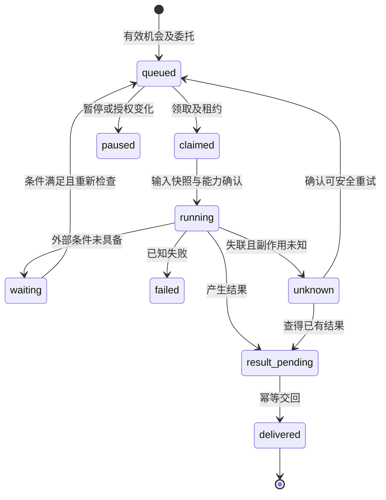

# 自主推进、等待与可靠运行

[总纲](../README.md) · [委托](管理与协作.md) · [上下文](上下文与历史.md) · [接口](../03-系统/接口与一致性.md)

## 持续工作的三个问题

AI 持续做事需要方向判断、有效委托和可恢复执行同时成立。项目里有一条“没完”只说明仍有工作，不表示它此刻最值得做、已经被授权或工具能执行。（经过 S05 §13/16/19/20、S06 续接与桥静态核对、D03/D08）

有新消息、依赖结果、相关材料变化、已承诺的下一段工作或明确约定的检查时间时，产生一次运行机会。服务先筛选可运行条件，再让负责参与者判断处理哪里；被选中的方向记录“为什么现在做它”和期望得到什么，不按创建顺序机械出队。

等待、暂停、结束、预算耗尽分别表达。没有新信息仍可继续理论推演，只要有实际值得开展的推理、反例、模型或问题重构；“保持运行”本身不是目标。（D08/D11）

## 方向判断看什么

负责的参与者在可运行的机会里挑一件时，至少看这几样，并把看到的写进「为什么现在做它」：（S11）

- **它挡着别的工作吗**：比如本机分支没推上来，后面几件都要等它。
- **放着会越来越难吗**：分支越放越偏，没取回的会话越积越多。
- **它是小林现在最在意的地方吗**：小林最近说的话指向哪里。
- **它会碰到能回答的东西吗**：代码运行、外部结果、真实材料、小林本人。会话 1 到 8 里出人意料的发现，都来自和外面的东西接触。
- **我能动它吗**：本次委托和这个端的实际能力够不够。云端会话动不了本机分支，本机 Claude Code 能。

这不是评分公式，也不规定先后。不同参与者带着不同能力进来，看到的「最值得」可以不同；给小林看的那一件，应当是只有他能做的事。项目记录哪些工作后来真的带来了改变，下一次判断可以参考这份记录。

## 从机会到结果

这是候选运行状态；项目、工作项和结果验证状态各自独立。若暂停发生在已经完成但尚未交回的运行上，仍接收并保存其结果，共享状态应用另检查权限。

## 持久化与恢复

排队前保存运行 ID、触发 ID、目标工作、委托及输入版本。执行者领取有期限的租约并带 fencing token；续租只维持执行权，不触发新的模型思考。旧租约结果仍可登记为待核产物，但旧执行者不能越过新 token 写共享状态。（D08）

外部动作分别保存 operation_id、幂等键、目标、发出状态和回执。服务可事务化的动作与结果待发送项在同一事务提交；跨外部系统时写请求记录再执行，执行后保存回执。进程在两者间退出，必须能看见“不确定”，不能回成“未执行”后自动重做。

结果采用持久待发送队列交回，接收方按 result_id 去重并返回回执；投递失败可以重试投递。外部动作本身只有在目标支持幂等键或核对已执行结果后才重试。这里承诺结果可核对和避免静默重复，不承诺任意外部系统的严格 exactly-once。

## 纠正、并发与暂停

共享更新使用起步时 expected_revision；依据已经改变时先保存成果，再比较差异。独立方案可继续存在；对已撤回委托或被纠正依据的更新不能悄悄覆盖新状态。必要时创建重新面对工作。

项目或委托暂停后，调度器停止领取新的相关工作；已运行的工作按工具能力取消，无法取消的跟踪到明确结果。暂停不删除排队原因和已有成果；恢复时重新核依赖、预算、委托与版本。

| 故障 | 候选处理 | 人回来能看到什么 |
|---|---|---|
| 桥进程退出 | 租约过期进入恢复检查，查本地运行和操作回执 | 谁失联、哪些动作已确认、哪些未知。 |
| 结果已产生但回调失败 | 重投同一 result_id，不重跑研究或外部动作 | 已完成结果与待交回状态。 |
| 依赖事件重复到达 | trigger+target 去重，保留重复来源 | 一次工作及全部有关线索。 |
| 两个端同时领取 | 原子领取及 fencing，落后的提交被拒绝或待核 | 独立成果、实际生效者与冲突。 |
| 外部动作状态未知 | 查询外部凭据，或交给有权限者核对 | 明确的不确定性及下一步。 |
| 新纠正到达时仍在运行 | 输入快照标过时，按影响决定暂停或继续 | 原依据、纠正和最终处理。 |

## 守望与有意义的回报

守望记录关注对象、等待条件、检查渠道、责任者、可调用资源及条件满足后的工作。只有有能力且被委托的检查才排期；无接入能力时显示人工等待。事件通知和定时检查是不同来源，都通过同一去重及授权检查。

人回来优先看到：得到的成果、改变的判断/安排、需要他决定的具体事、暂停原因和可进入的新方向。没有实质变化时保留运行结果，不把重复文本、调用次数或耗时标作进展。对于理论工作，能够明确提出新结构、排除一种解释或打开原来未见的问题，也可以是重要结果。（V10）

首版完成一端的持久运行、回流、暂停及故障恢复；复杂跨项目优先级、长期自动研究及多端调度逐步深化。首版范围不能仅有数据库表而没有一次真实执行与可靠回流，见 V06/V07/V08。（D06/D08）
