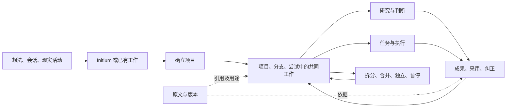

# Cognos「项目部分」设计总纲

> 放进仓库时加的说明（11/03）：这套是 GPT 写的。它和同一目录上一级的 Claude「项目部分设计」是分别写的，两者哪里一致、哪里不同，见 [../README.md](../README.md)。

更新：2026-11-03｜版本：分层工作稿 0.1｜本次交付：设计文档，不含产品实现。（来源：本次交付）

这一组文件承接「为 Cognos 的『项目部分』建立完整、可维护的分层设计文档体系」的请求。它把已取得的项目空间、分支、尝试、会话、管理、协作与持续运行设计放在同一套操作关系里；未取得的旧会话正文不补写成事实。（小林 2026-11-03 当前请求）

项目部分的候选主线：人可以先记录、交谈或尝试；值得持续投入时确立项目；项目中可以同时探索问题、安排执行、面对结果、修订判断和重新组织。原始内容、各位置的使用方式、项目采用的安排、实际运行结果分别保留，后来的人和 AI 可以从原处或另一处继续。（承接 R01–R10、D01–D08，编号见下方台账）

## 从哪里读

| 现在要处理什么 | 主文件 | 接着读 |
|---|---|---|
| 核对是谁说的、确认了什么、哪些没读到 | [来源与要求](00-依据/来源与要求.md) | [分歧与待决](00-依据/分歧与待决.md) |
| 看整体对象和用户怎样工作 | [产品与对象](01-产品/产品与对象.md) | [项目空间与导航](01-产品/项目空间与导航.md) |
| 处理还没有项目的开始，以及拆分、合并 | [开始与重组](01-产品/开始与重组.md) | [数据模型](03-系统/数据模型.md) |
| 设计一项尝试如何持续，如何承接会话 | [尝试、会话与材料](01-产品/尝试会话与材料.md) | [上下文与历史](02-协作/上下文与历史.md) |
| 看负责人、工作安排、采用与纠正 | [管理与协作](02-协作/管理与协作.md) | [判断采用与纠正](02-协作/判断采用与纠正.md) |
| 让 AI 选择方向、做事、等待与恢复 | [自主推进与可靠运行](02-协作/自主推进与可靠运行.md) | [接入与能力核验](03-系统/接入与能力核验.md) |
| 开始实现前确定存储和操作契约 | [数据模型](03-系统/数据模型.md) | [接口与一致性](03-系统/接口与一致性.md) |
| 核对现有产品能复用什么、整体依赖在哪里 | [Cognos 依赖与实现边界](03-系统/Cognos依赖与实现边界.md) | [阶段与验证](04-交付/阶段与验证.md) |
| 验收，或让下一位维护者继续 | [阶段与验证](04-交付/阶段与验证.md) | [维护与覆盖](04-交付/维护与覆盖.md) |

## 整体关系

图表达可往返的候选关系；直接建项目、没有固定目标的探索、只共用材料而分别工作都成立。（D01、D02）

## 本组的核心选择

| 设计选择 | 作用及代价 | 状态与主文件 |
|---|---|---|
| 导航允许树形，内容和使用关系允许多对多 | 名字导航清楚；需要独立处理历史位置和访问范围 | AI 候选 D01；产品与对象、数据模型 |
| 原文、解释、采用、运行分别存放 | 能追溯一次变化；读者需要知道当前看的是哪一层 | AI 候选 D02；判断采用与纠正 |
| AI 在明确委托内直接维护工作 | 减少逐次等待；需要版本校验、资源边界和撤回 | AI 候选 D03；管理与协作 |
| 同一来源在不同位置有不同用途和采用记录 | 一处改判断时不会抹平其他处；影响检查更细 | AI 候选 D04；尝试会话与材料 |
| 前沿可有多个，历史可成为新的切入点 | 支持“回来从另处进入”；方向选择需要给出理由 | AI 候选 D05；上下文与历史 |
| 首个可用版包含真实工作闭环与基础重组 | 结构能在实际工作中被检验；首版工作量更大 | AI 候选 D06；阶段与验证 |
| 共享资料与服务，不预定四种产品形态相同 | 为笔记、组织、学习保留各自工作方式 | AI 候选 D07；Cognos 依赖与实现边界 |
| 输入快照、运行、操作回执和结果投递可恢复 | 减少失联及重试造成的重复；增加持久状态 | AI 候选 D08；自主推进与可靠运行 |
| 小林本人的决定单独一块，每个参与者进来先看到 | 几个 AI 同时工作时不再靠小林转述；只放小林原话，不长成规矩清单 | 11/03 从 Claude 设计补入；判断采用与纠正、V12 |

这些是这一版为保持一致而选用的工作假设，尚未获得用户逐条确认。被替换的互斥主张仍在[分歧台账](00-依据/分歧与待决.md)，源码与运行事实的核验范围见[实现边界](03-系统/Cognos依赖与实现边界.md)。

## 已取得的要求与尚未完成的事

项目总览只显名字、各层可对话、同一会话可出现在多处、尝试有简介及阶段总结、四类客户端接入，是已有阅读记录转述的明确选择；Initium 改名有结构稿保存的用户原话。本组没有把这些二手记录升级成已重新核验的会话全文。（来源：S03–S05；详见 R02–R07）

本次已将所有请求领域展开到对象、操作、失败情形和验收，完成文件与交叉引用检查；完整八份讨论、所引分支的隐藏助手正文、四端实测及产品运行验收仍缺。它们各有明确补读或验证入口，当前文档可以继续使用和修订。（来源：本组交付范围；待核范围见 G01–G04、Q01–Q08）
